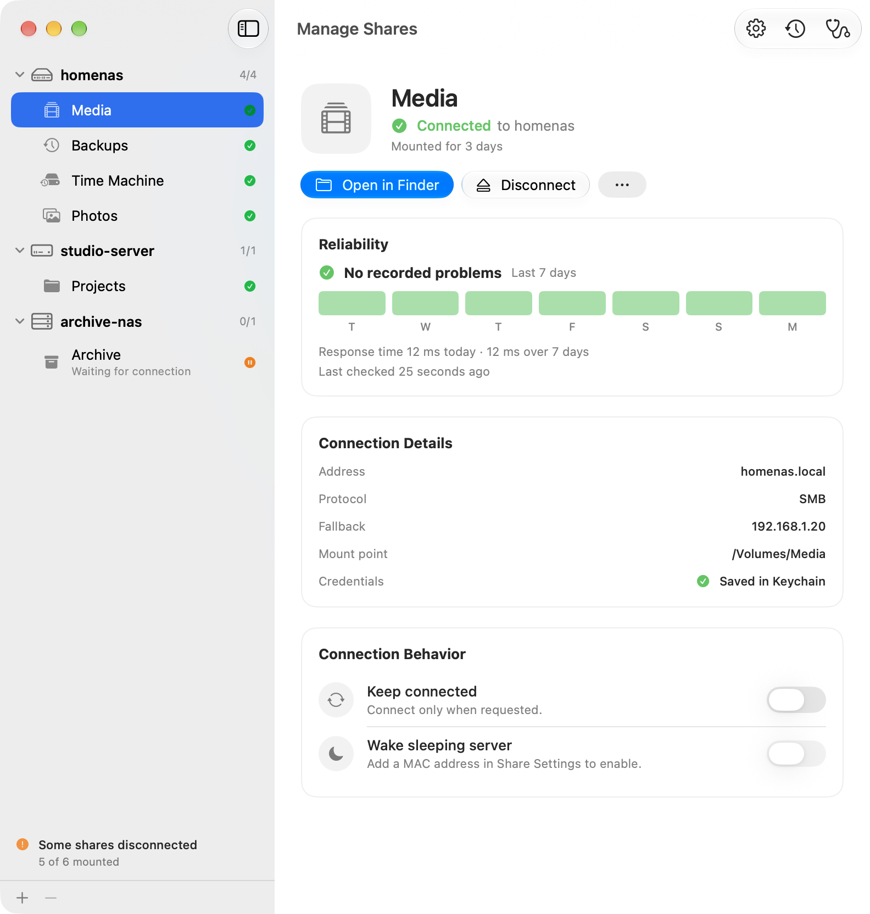

<p align="center">
  
</p>

# 🦦 Otter

<p align="center">
  <a href="https://github.com/maxhewett/ShipHook"></a>
  
  
  <a href="LICENSE"></a>
  
</p>

A lightweight native macOS menu bar app that monitors configured network shares and helps keep them connected.

Otter attempts to reconnect shares after sleep, network changes, VPN reconnects, or unexpected disconnects. It gives Finder, Plex, backup jobs, and other apps a better chance of finding the volumes they expect when the server and network are available.

Built entirely in Swift, Otter is designed to feel at home on macOS: fast, efficient, and unobtrusive.

<p align="center">
  
</p>

## Why "Otter"?

Otters are small, quick, and famously good at not letting important things drift away. This app does the same for your network volumes: it keeps a quiet paw on the shares you care about and nudges them back into place when sleep, Wi-Fi, or VPN tides pull them loose.

## Features

- 📁 Monitors configured network shares and attempts to restore their connections after sleep, wake, network changes, and unexpected disconnects
- 🔒 Connects on a registered network or an active VPN, and can start compatible VPN services that macOS exposes to it
- 🧭 Guides SMB setup with mounted-share import, SMB discovery, the native macOS share picker, and a Connection Readiness test
- 🔌 Handles slow or sleeping servers with reachability monitoring, Wake-on-LAN, hostname fallback, and safe recovery tools
- 🔐 Uses macOS Keychain for SMB credentials, with an opt-in password-encrypted backup for eligible credentials; plain exports exclude credentials and diagnostic reports redact identifying share details
- ⏸️ Provides flexible pause controls, actionable notifications, and App Intents for everyday management
- 👀 Notices shares mounted outside Otter and offers to manage them, with an offer that waits in the menu bar until you answer it
- 🩺 Verifies mounted volumes with responsive and optional writable checks, tracks recent reliability, and can open Finder to refresh a saved credential
- 🔗 Includes actions for mounting, disconnecting, pausing, resuming, status, reliability, and credential refresh
- 🩺 Per-share diagnostics explain mount, routing, and latency; SMB shares also include SMB-channel analysis and optional share-performance tests ([diagnostics guide](docs/nas-diagnostics.md))
- 🏢 Supports versioned configuration transfer, protected backups, and managed deployment through MDM ([configuration reference](docs/managed-deployment.md))
- 🍎 Runs as a lightweight native menu bar app with launch-at-login and automatic updates
- ⌨️ Includes `otterctl` for local shell automation: status, mount, disconnect, pause, resume, and redacted diagnostic export

No shell setup. No helper daemon. No fuss.

Just an otter that never lets go.

## How it works

Otter watches for the moments shares tend to drop—wake from sleep, network path changes, volumes mounting or unmounting—and checks that each configured share is still where it should be. If one is missing, it attempts to remount it using native macOS NetFS APIs, with retry backoff when the server isn't reachable yet. Shares with Wake-on-LAN enabled send a magic packet before retrying an unreachable server. A low-frequency fallback check catches anything the system events miss. Otter cannot reconnect a server that is unavailable, a share whose credentials have changed, or a path macOS cannot mount.

The first-run assistant can import shares already mounted in Finder, show nearby SMB servers, check the saved SMB addresses in Keychain, or take you to manual setup. Keychain discovery reads only server and share address metadata; it never reads usernames or passwords, and it checks a server only after you choose it. Browsing a nearby or saved server uses macOS's native authentication and share-selection UI, so credentials continue to be handled by the system and Keychain. The same options remain available later when adding another share.

## Using Otter

1. Open Otter and follow the first-run assistant.
2. Import a mounted Finder share, choose a nearby or saved SMB server, or enter a network-share address manually.
3. Review the share and save it.
4. Optional: add VPN or Wake-on-LAN details, or choose how Otter should maintain the connection.

Connection paths are configured per share. Otter can register the network where a share was set up (its IPv4 subnet, plus the Wi-Fi name when available) and connect whenever the Mac is back on that network — over Wi-Fi or Ethernet. A VPN can be enabled as an alternative path for use away from that network. Otter can wait for you to connect the selected VPN, or start a compatible VPN service that macOS exposes through System Configuration. For app-managed VPNs such as WireGuard, Otter can recognize a live tunnel and test server reachability, but cannot reliably identify or start a specific profile. If Otter cannot confirm that the selected VPN is active and the server does not answer, the share waits quietly instead of reporting an error. A confirmed VPN, a manual connection attempt, or a previously connected share can still surface a genuine connection problem.

For hostname-based shares, Otter resolves ordinary hostnames and Bonjour SMB service identities to learn the server's local IP address while you are on the local network. The hostname always remains the primary address; the IP is a fallback for situations such as a VPN that cannot resolve Bonjour or `.local` names. Otter keeps a small private history of address changes and warns after repeated changes within 30 days, which can indicate that a DHCP reservation would make fallback connections more reliable. To let macOS authenticate the IP-based fallback, Otter may create a scoped alias of the Finder-saved credential in macOS Keychain. Otter removes its alias when the cached IP changes or the share is deleted. Learned addresses and their history are excluded from exported configurations and redacted diagnostic reports.

## Requirements

- macOS 15.0 or later on Apple silicon or Intel. Otter is visually optimized for macOS Tahoe 26 and uses native controls on macOS Sequoia 15.
- Matching by Wi-Fi name needs Location Services access (macOS only exposes Wi-Fi network names to apps with location permission — Otter will ask when needed). Subnet-based matching works without it.
- Local Network access may be requested so Otter can check server reachability

## Building

Open `Otter.xcodeproj` in Xcode 26 or newer and run the `Otter` scheme. The app targets macOS 15.0 and the only dependency is [Sparkle](https://sparkle-project.org), fetched automatically via Swift Package Manager.

Run the tests with:

```sh
xcodebuild test -project Otter.xcodeproj -scheme Otter -destination 'platform=macOS'
```

For the full source and product checks before a ShipHook release, see the
[release-readiness checklist](docs/release-readiness.md).

## Command line

The built app contains a local automation command at `Otter.app/Contents/MacOS/otterctl`. It talks only to the running Otter app through macOS distributed notifications; it does not open a network port.

```sh
OTTERCTL="/Applications/Otter.app/Contents/MacOS/otterctl"
"$OTTERCTL" status
"$OTTERCTL" mount "Media"
"$OTTERCTL" pause
"$OTTERCTL" export-diagnostics ~/Desktop/otter-diagnostics.txt
```

## License

Otter is open source under the [MIT License](LICENSE). You're free to use, modify, and redistribute it — just keep the copyright notice, which credits the original app.

For help, privacy information, or a security report, see [SUPPORT.md](SUPPORT.md),
[PRIVACY.md](PRIVACY.md), and [SECURITY.md](SECURITY.md).
